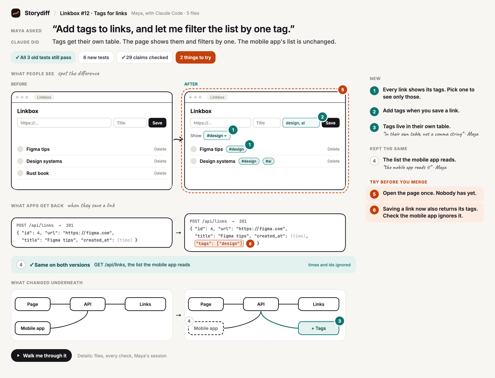

# Storydiff

**The agent that made the PR hands it over like a person would: one review card, every claim checked.**



## In 30 seconds

Agents write most pull requests now, and reviewers are tired of reading long diffs written by
robots. With Storydiff, the coding agent that made the PR writes a short handover from its own
session: what the human asked for, what it did, what changed, what it left alone on purpose, and
what still needs a human's eyes.

Storydiff checks every line of that handover. A `file:line` must exist in the new code. A test
must exist and pass. A quote must match what the human really typed in the session. Old tests run
on both versions, so "no regressions" is a fact. Then it captures the old and the new app side by
side and draws one card.

The reviewer opens the PR and the card is the first comment. They read it in one look, refer to
items by number ("re ⑥: …") and approve as usual. Every push refreshes the card, and the
`storydiff` status fails when a claim doesn't hold up.

## Install

### Authors (Claude Code)

First install the `storydiff` CLI from source (Node 22+). It isn't on npm:

```bash
git clone https://github.com/pulkitnagpal/storydiff
```

```bash
cd storydiff && npm install && npm run build && npm link
```

`npm link` gives you a global `storydiff` command. The one-line alternative builds it through the
package's `prepare` script:

```bash
npm install -g github:pulkitnagpal/storydiff
```

Then add the plugin in Claude Code:

```
/plugin marketplace add pulkitnagpal/storydiff
/plugin install storydiff@storydiff
```

Work as usual. When the change is ready, run `/storydiff` (or just say "raise the PR").
Claude writes `handover.storydiff`, captures the before and after, checks every claim, fixes or
drops the lines that don't hold up, and opens the card so you see exactly what the reviewer will
see. Say yes once and it pushes, opens or updates the PR, and publishes the card. You write nothing.

The plugin also needs `git`, `gh` signed in for publishing, and Chrome, Brave or Edge for the card
image. If `storydiff` isn't on your PATH, `/storydiff` stops and tells you the install line.

`/storydiff write` only writes and checks the file. `/storydiff publish` publishes a card you have
already looked at.

### Authors (Codex, Cursor and other agents)

Paste [docs/AGENTS.storydiff.md](docs/AGENTS.storydiff.md) into your repo's `AGENTS.md` (or your
agent's rules file). It is the same guide the plugin uses, plus the five CLI steps, and needs the
same `storydiff` CLI installed from source. Quotes are
checked when the agent can pass its transcript to `storydiff check --session <file>`; otherwise
they are shown as not checked.

### Reviewers

Nothing to install. Open the PR on GitHub. The first comment is the card as an image, then the
numbered list as text, then the map as a collapsed Mermaid diagram. Review in GitHub as usual and
refer to items by their number.

What the card tells you:

- **The verdict line**: old tests still passing, new tests, claims checked, things to try.
- **Asked → did**: the human's own words, and the approach in one line.
- **Before → after**: the screen, the API response, the pipeline or the scenario, captured from
  both versions. Pins carry the list's numbers.
- **Underneath**: the parts of the system that changed, as boxes and arrows.
- **The list**: new or changed, kept the same, try before you merge.

Code and test proofs are re-checked on every push by the Action. Quotes are checked on the
author's machine, because the session log never leaves it; the comment says at which commit.

### Repo owners

Add [docs/examples/storydiff.yml](docs/examples/storydiff.yml) as `.github/workflows/storydiff.yml`:

```yaml
name: storydiff
on:
  pull_request:
    types: [opened, synchronize, reopened, edited]
permissions:
  contents: write       # card images go on the storydiff-cards branch
  pull-requests: write  # the one sticky comment
  statuses: write       # the storydiff status
jobs:
  storydiff:
    runs-on: ubuntu-latest
    steps:
      - uses: pulkitnagpal/storydiff@main
        with:
          setup: npm ci   # whatever installs your project, so the cited tests can run
```

No server, no account, no keys beyond the default `GITHUB_TOKEN`. The Action builds the CLI from
its own source (`npm ci && npm run build` in the action's folder), so nothing comes from npm.

To block merges on a failing claim, make the `storydiff` status required in your branch protection rules.

On each push the Action:

1. reads the spec from the PR description's ` ```storydiff ` block (written by `storydiff publish`),
   or from `handover.storydiff` in the branch;
2. runs `storydiff capture` when the spec has `show` lines (a failed capture leaves the pictures
   out; it never fakes them);
3. re-runs `storydiff check` for code and test proofs, and takes the quote results the author
   published;
4. renders the card with `storydiff render --png --md`;
5. commits the PNG to the orphan `storydiff-cards` branch and links it through github.com, so the
   image loads in private repos for anyone who can see the repo;
6. creates or updates one comment (card image, numbered list, collapsed Mermaid fallback);
7. sets the `storydiff` status: failing when a claim doesn't hold up or an old test now fails.

| Input | Default | What it does |
| --- | --- | --- |
| `setup` | `""` | Command that installs the project, e.g. `npm ci`, so cited tests can run. |
| `test-cmd` | CLI default | Passed to `storydiff check --test-cmd`. |
| `capture` | `auto` | `auto` captures when the spec has `show` lines; `true` or `false` to force. |
| `node-version` | `22` | Node to set up; `""` keeps the runner's. |
| `checkout` | `true` | Check out the PR head with full history. Set `false` if you already did. |
| `spec-file` | `handover.storydiff` | Fallback when the PR description has no block. |
| `cards-branch` | `storydiff-cards` | Where card images are stored. |
| `status-context` | `storydiff` | Name of the status. |
| `strict-quotes` | `false` | Fail when a quote was never checked on the author's machine. |
| `fail-job` | `false` | Also fail the job, not only the status. |
| `cli` | `""` | Run this command instead of the CLI built from the action's source. |

Outputs: `state`, `comment-url`, `card-url`.

Pull requests from forks get a read-only `GITHUB_TOKEN`, so the Action can't comment or set the
status there; it writes the card to the run summary instead. The Action never hands the token to
the CLI, which runs your tests.

## The handover file

`handover.storydiff` is a small, line-based language (v0.3). The full guide, with an example, is
[plugin/skills/storydiff/language.md](plugin/skills/storydiff/language.md). A taste:

```
title  "Tags for links"
ask    "Add tags to links, and let me filter the list by one tag."
did    "Tags get their own table. The page shows them and filters by one."

show screen / "What people see"

screen page "Page"
endpoint api "API"
page -> api

+ table tags "Tags" "Tags live in their own table."
    said @03:11 "in their own table, not a comma string"
    proof db.js:12
! "Open the page once. Nobody has yet."
    pin screen page
```

## CLI

```
storydiff capture --base <ref>      capture each show line from the old and the new version
storydiff check [--session ID|FILE] check every claim, write .storydiff/report.json, exit 1 on a failure
storydiff render [--html F] [--png F] [--md F] [--image-url URL]
storydiff view                      open the card in the browser
storydiff publish [--pr N]          put the spec in the PR description and post the card comment
```

## Developing

```bash
node --test 'action/test/*.test.mjs'
```

```bash
claude plugin validate ./plugin
```

To try the plugin from a checkout: build and link the CLI (`npm install && npm run build && npm link`),
then add the checkout as a marketplace with `/plugin marketplace add ./path/to/storydiff` and run
`/plugin install storydiff@storydiff`. Edits to `plugin/` take effect after `/reload-plugins`.

`docs/AGENTS.storydiff.md` is generated from the plugin's guide: run
`node scripts/agents-snippet.mjs` after editing `language.md`.

Design notes: [docs/design.md](docs/design.md), [docs/v1-build.md](docs/v1-build.md). The card's
design is locked in `poc/v3/canvas/`.

## License

[MIT](LICENSE)
